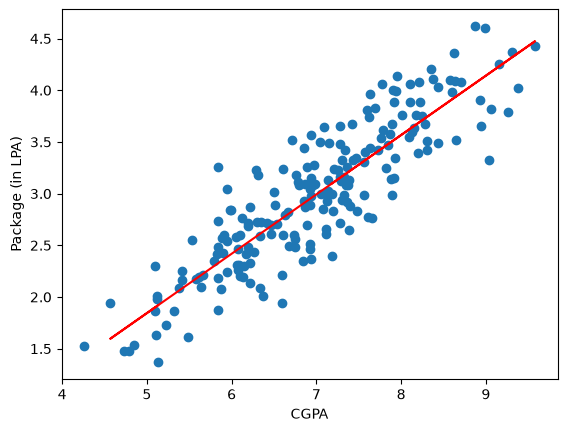
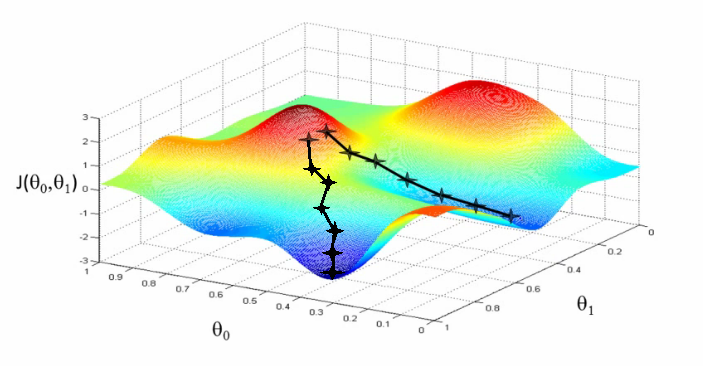

# Simple Linear Regression

- Supervised Learning Algorithm
- Work on problem that have a numeric output
- There are different types of linear regression
  1 - Simple LR
  2 - Multi LR
  3 - Polynomial LR
  4 - Regularization (comes at very end)

---

**Only have one dependent factor**

**Example** -> suppose you have a college data of student package and there cgpa. so in this case we have 1 input column that is cgpa and 1 output column package. so here cgpa is the one factor that package is dependent on.

so like with this kind of data we can build a predictive model that can give us the package based on student cgpa

`There are other factors on which our data also rely but we cannot put them in matehematical terms so those factors are called stochastic error`

**Stochastic Error** - a random component added to a regression or econometric model to account for the variation in the dependent variable that cannot be explained by the model's independent variables

Simple Linear Regression Equation -> `y = mx + b`

Our goal is to find the best line that passes as closely as possible to all the data points.

In a Nutshell, we need to find `m` and `b` to find the line closet to all the points.

`In human terms we can understand that m is like weight like how much emphasis does x hold in getting the y value. and b tells us the offset that if there is no input(x) then also we have some value of y.`

To find the `m` and `b` we have two ways:

1. Closed Form Solution
2. Non-Closed Form Solution

### `Closed Form Solution`
An Expression in Mathematical expression expressed using finite number of stand operations. It may contain constants, variables or certain operations and functions, but usually no limit, differentiation, or integration. The set of operations and functions admitted in a closed form expression may vary with author and content.

To Calculate the `m` and `b` using this, we have `Ordinary Least Square (OLS)`. It is kind of a direct formula to find `m` and `b`

To use This method in python we can simply use the `LinearRegression()` class.

So, the direct formula to calculate the `m` and `b`  is:

$$
b = \bar{y} - m\bar{x}
$$

$$
m = \frac{\sum_{i=1}^{n}(x_i-\bar{x})(y_i-\bar{y})}
{\sum_{i=1}^{n}(x_i-\bar{x})^2}
$$

Here  $ \bar{x} $ and $ \bar{y} $  are the mean of  values

from the code we can see that the,
$ \bar{x} $ is the mean value `CPGA` and,
$ \bar{y} $ is the mean value of `Package`

and $x_i$ is the current row's `CPGA` and $y_i$  is the current row's `Package`.

Lets, see how these formulas were calculated,

So, when we create our best fit line it does not pass perfectly from all over the points there is some gap that is left as we can see in the picture.

Here we can clearly see the our, best fit line does not pass through all the points. there is some gap. So, lets name the distance between the best fit line and a points as $d_i$

So, the total distance can be

$$
    E = d_1 + d_2 + d_3 + ...... + d_n
$$ 
But, here is one issue we can see that our points are below the line and and above the best fit line so when we calculate our distances for each point then it can be negative and postive so adding up all of the distances does not really give us the total distance in this case so what we can do is we can sqaure our distances to get the total distance. so our new equation will be 

$$ 
    E^2 = d_1^2 + d_2^2 + d_3^2 + ...... + d_n^2

$$
But we have our methods here as well like we can use `Modulus`. As we move deeper into the concept we get to know that we need to use differentiation in this and we know that the `modulus function is not differentiable at zero` . On the other when we sqaure we can do differentiation at any point.

`So, our error function will be`

$$
    E = {\sum_{i=1}^{n}d_i^2}
$$
so we need to find `m` and `b` such that this `Total Error Distance` is least.

now we also know that we can write the $d_i$ as $y_i -  \hat{y_i}$

here, $y_i$ is the original value and, $\hat{y_i}$ is the perdicted value.

so our equation can be ,

$$
E = {\sum_{i=1}^{n}(y_i - \hat{y_i})^2}
$$

so to find the best `m` and `b` we need to have both the values in the equation then only it will be easier to find.

we know we can write $\hat{y_i} = mx_i + b$, so our equation can be,

$$
E = {\sum_{i=1}^{n}(y_i - mx_i - b)^2}
$$ 
so, know our equation is dependent on both `m` and `b`.

know, if we take `b=0`, our equation wll be,
$$
E = {\sum_{i=1}^{n}(y_i - mx_i)^2}
$$ 
and, if we take `m=1`(so that $x_i$ is there in equation), then our equation will be,
$$
E = {\sum_{i=1}^{n}(y_i - x_i - b)^2}
$$  
now, if we plot the garph of these two equation then we get something similar to a quadratic($x^2$) graph. Not exactly same but somewhat similar to it.

Know, if we plot the graph in 3d for E, m and b then it would be something like this, 

`This is called a Gradient Descent`

Here, the red represents the maximum error and blue represents the minimum error so by this we can evalute like for which values we can get the least Error.

So, to find out the m and b for that we can use `Maxima and Minima`

so, whenever we are our at minimum our slope is zero. and to find the slope we need to find the derative and then equate it with zero.

so in this case as our equation depends on two factors we need to use `Partial differentiation`.
$$
\frac{\partial E}{\partial m} = 0,\quad \frac{\partial E}{\partial b} = 0
$$

so, know solving these two we can get the m and b values  and our final result will be.

$$
b = \bar{y} - m\bar{x}
$$
$$
m = \frac{\sum_{i=1}^{n}(x_i-\bar{x})(y_i-\bar{y})}
{\sum_{i=1}^{n}(x_i-\bar{x})^2}
$$

`The code implementation of this linear Regression from scratch is done in code-1.ipynb`

---

### `Non-Closed Form Solution`
A Mathematical solution that cannot be written using finite number of standard operarions and elementary functions. Instead, it relies on infinite series, limits, un-evaluated integrals, special functions or numerical/iterative approximations.

To Calculate the `m` and `c` using this ,we have `Gradient Descent` in this.

`Ques. Now the question is that when we have a direct formula in closed form solution then why do we need another method to find out the values?`
Ans. This is because as we move deeper into more complex problems we get into higher dimensions it is tough to find m and c values using direct formula so that is why we need this method 

To use this method in python we can need to use the `SGDRegession()` class

---

So, know to check how good is Linear Regression model we have few checks for that:

