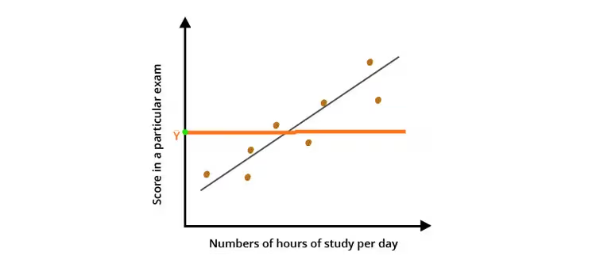

# Simple Linear Regression

- Supervised Learning Algorithm
- Work on problem that have a numeric output
- There are different types of linear regression
  1 - Simple LR
  2 - Multi LR
  3 - Polynomial LR
  4 - Regularization (comes at very end)

---

**Only have one dependent factor**

**Example** -> suppose you have a college data of student package and there cgpa. so in this case we have 1 input column that is cgpa and 1 output column package. so here cgpa is the one factor that package is dependent on.

so like with this kind of data we can build a predictive model that can give us the package based on student cgpa

`There are other factors on which our data also rely but we cannot put them in matehematical terms so those factors are called stochastic error`

**Stochastic Error** - a random component added to a regression or econometric model to account for the variation in the dependent variable that cannot be explained by the model's independent variables

Simple Linear Regression Equation -> `y = mx + b`

Our goal is to find the best line that passes as closely as possible to all the data points.

In a Nutshell, we need to find `m` and `b` to find the line closet to all the points.

`In human terms we can understand that m is like weight like how much emphasis does x hold in getting the y value. and b tells us the offset that if there is no input(x) then also we have some value of y.`

To find the `m` and `b` we have two ways:

1. Closed Form Solution
2. Non-Closed Form Solution

### `Closed Form Solution`
An Expression in Mathematical expression expressed using finite number of stand operations. It may contain constants, variables or certain operations and functions, but usually no limit, differentiation, or integration. The set of operations and functions admitted in a closed form expression may vary with author and content.

To Calculate the `m` and `b` using this, we have `Ordinary Least Square (OLS)`. It is kind of a direct formula to find `m` and `b`

To use This method in python we can simply use the `LinearRegression()` class.

So, the direct formula to calculate the `m` and `b`  is:

$$
b = \bar{y} - m\bar{x}
$$

$$
m = \frac{\sum_{i=1}^{n}(x_i-\bar{x})(y_i-\bar{y})}
{\sum_{i=1}^{n}(x_i-\bar{x})^2}
$$

Here  $ \bar{x} $ and $ \bar{y} $  are the mean of  values

from the code we can see that the,
$ \bar{x} $ is the mean value `CPGA` and,
$ \bar{y} $ is the mean value of `Package`

and $x_i$ is the current row's `CPGA` and $y_i$  is the current row's `Package`.

Lets, see how these formulas were calculated,

So, when we create our best fit line it does not pass perfectly from all over the points there is some gap that is left as we can see in the picture.

Here we can clearly see the our, best fit line does not pass through all the points. there is some gap. So, lets name the distance between the best fit line and a points as $d_i$

So, the total distance can be

$$
    E = d_1 + d_2 + d_3 + ...... + d_n
$$ 
But, here is one issue we can see that our points are below the line and and above the best fit line so when we calculate our distances for each point then it can be negative and postive so adding up all of the distances does not really give us the total distance in this case so what we can do is we can sqaure our distances to get the total distance. so our new equation will be 

$$ 
    E^2 = d_1^2 + d_2^2 + d_3^2 + ...... + d_n^2

$$
But we have our methods here as well like we can use `Modulus`. As we move deeper into the concept we get to know that we need to use differentiation in this and we know that the `modulus function is not differentiable at zero` . On the other when we sqaure we can do differentiation at any point.

`So, our error function will be`

$$
    E = {\sum_{i=1}^{n}d_i^2}
$$
so we need to find `m` and `b` such that this `Total Error Distance` is least.

now we also know that we can write the $d_i$ as $y_i -  \hat{y_i}$

here, $y_i$ is the original value and, $\hat{y_i}$ is the perdicted value.

so our equation can be ,

$$
E = {\sum_{i=1}^{n}(y_i - \hat{y_i})^2}
$$

so to find the best `m` and `b` we need to have both the values in the equation then only it will be easier to find.

we know we can write $\hat{y_i} = mx_i + b$, so our equation can be,

$$
E = {\sum_{i=1}^{n}(y_i - mx_i - b)^2}
$$ 
so, know our equation is dependent on both `m` and `b`.

know, if we take `b=0`, our equation wll be,
$$
E = {\sum_{i=1}^{n}(y_i - mx_i)^2}
$$ 
and, if we take `m=1`(so that $x_i$ is there in equation), then our equation will be,
$$
E = {\sum_{i=1}^{n}(y_i - x_i - b)^2}
$$  
now, if we plot the garph of these two equation then we get something similar to a quadratic($x^2$) graph. Not exactly same but somewhat similar to it.

Know, if we plot the graph in 3d for E, m and b then it would be something like this, 

`This is called a Gradient Descent`

Here, the red represents the maximum error and blue represents the minimum error so by this we can evalute like for which values we can get the least Error.

So, to find out the m and b for that we can use `Maxima and Minima`

so, whenever we are our at minimum our slope is zero. and to find the slope we need to find the derative and then equate it with zero.

so in this case as our equation depends on two factors we need to use `Partial differentiation`.
$$
\frac{\partial E}{\partial m} = 0,\quad \frac{\partial E}{\partial b} = 0
$$

so, know solving these two we can get the m and b values  and our final result will be.

$$
b = \bar{y} - m\bar{x}
$$
$$
m = \frac{\sum_{i=1}^{n}(x_i-\bar{x})(y_i-\bar{y})}
{\sum_{i=1}^{n}(x_i-\bar{x})^2}
$$

`The code implementation of this linear Regression from scratch is done in code-1.ipynb`

---

### `Non-Closed Form Solution`
A Mathematical solution that cannot be written using finite number of standard operarions and elementary functions. Instead, it relies on infinite series, limits, un-evaluated integrals, special functions or numerical/iterative approximations.

To Calculate the `m` and `c` using this ,we have `Gradient Descent` in this.

`Ques. Now the question is that when we have a direct formula in closed form solution then why do we need another method to find out the values?`
Ans. This is because as we move deeper into more complex problems we get into higher dimensions it is tough to find m and c values using direct formula so that is why we need this method 

To use this method in python we can need to use the `SGDRegession()` class

---

`An outlier is a data point that is significantly different from the majority of other observations.`

So, know to check how good is Linear Regression model we have few checks for that:

1. MAE - Mean Absolute Error
2. MSE - Mean Squared Error
3. RMSE - Root Mean Squared Error
4. R2 Score
5. Adjusted R2 Score

### MAE

The average of the absolute differences between actual (observed) values and predicted values.
It measures prediction error in the same units as the target variable.

$$
MAE = \frac{1}{n}\sum_{i=1}^{n}|y_i - \hat{y}_i|
$$
Advantages:

1. **Less sensitive to outliers:** Unlike MSE, MAE does not square errors, so large errors are not disproportionately penalized.
2. **Same unit as the target variable:** If the target is measured in rupees, MAE is also measured in rupees.

Disadvantages:

1. **Not differentiable at zero:** The absolute value function has a sharp point at zero, making ordinary gradient-based optimization more difficult.

### MSE

The average of the square of  differences between actual (observed) values and predicted values. 

$$
MAE = \frac{1}{n}\sum_{i=1}^{n}(y_i - \hat{y}_i)^2
$$
Advantages: 

1. Can be used a Loss Function as it is differentiable.

Disadvantage:

1. MSE unit is square of output's (y)  unit so it is tough to interpret.
2. Not robust to outliers. 

### RMSE

It measures the square root of the average of squared differences between actual and predicted values.

$$
RMSE = \sqrt{\frac{1}{n}\sum_{i=1}^{n}(y_i-\hat{y}_i)^2}
$$

Advantages

1. **Penalizes large errors:** Squaring gives larger errors disproportionately more weight.
2. **Same unit as target variable:** Taking the square root brings the metric back to the original unit.
3. **Differentiable:** Smooth and differentiable, making it suitable for gradient-based optimization.
4. **Useful for regression:** Helps evaluate how far predictions are from actual values.

Disadvantages

1. **Sensitive to outliers:** A few large errors can significantly increase RMSE.
2. **Less intuitive than MAE:** Squared errors make the intermediate calculation harder to interpret.
3. **Cannot show error direction:** It does not indicate whether predictions are higher or lower than actual values.
4. **Scale-dependent:** RMSE cannot be directly compared across datasets with different target scales.

### R2 Score

It is a regression evaluation metric that tells us how well our model explains the variation in the target variable.

In simple terms, it tells us how much better our model performs compared to simply predicting the mean (average) of the actual values.

$$
R^2 = 1 - \frac{SS_{res}}{SS_{tot}}
$$

Expanded Formula: 

$$
R^2 = 1 - \frac{\sum_{i=1}^{n}(y_i-\hat{y}_i)^2}{\sum_{i=1}^{n}(y_i-\bar{y})^2}
$$

Where:
- $y_i$ = Actual value
- $\hat{y}_i$ = Predicted value
- $\bar{y}$ = Mean of actual values
- $SS_{res}$ = Sum of squared residuals (prediction errors)
- $SS_{tot}$ = Total sum of squares (variation from the mean)

Example: 

Here the `Red Line` is the mean values line ($\bar{y}$) and `Black Line` is our Predicted values line ($\hat{y}_i$) 

So, now what does the R2 score tells us,

lets say if our `R2 = 0` then, it means that our `Regression Line` and `Mean Values Line` is giving the same error i.e. both the lines are same. 

if `R2 = 1` then, it means that our Regression model is 100% accurate i.e. both predicted and actual values are equal.

so, generally our R2 score goes between 0 and 1. where 0 is the worst and 1 is the best. so the closer the score is to 1 the better is our model.

`Note:` In some cases the R2 score can come `-ve` as well. This suggest that we might have trained our model on wrong set of data or there our some error in the training method of our model as it is way off then the mean values line.

There is also another way to understand the R2 score.

Lets say, our `R2 = 0.80`, This means that our model explains 80% of variance.

i.e. this much `amount`  in the `output column`, is been explained by the `input column`

### Adjusted R2 Score

Adjusted R² is an improved version of R² that considers the number of independent variables (features) used in a regression model.

Unlike R², which generally increases or stays the same when we add more features, Adjusted R² penalizes the model for adding unnecessary features.

#### Why do we need Adjusted R²?

Suppose you're building a house-price prediction model.

Initially, you use:
- Area
- Number of bedrooms
- Location
Your model achieves an R² score of 0.85.

Now you add another feature:

- House owner's favourite colour

Even if this feature has no meaningful relationship with house prices, R² might increase slightly simply because another variable was added.

The problem: R² doesn't adequately penalize unnecessary features.

Adjusted R² solves this problem by considering the number of features in the model.

#### Formula: 

$$
Adjusted\ R^2 = 1 - \left(\frac{(1-R^2)(n-1)}{n-k-1}\right)
$$

Where:
- $R^2$ = R² score
- $n$ = Number of observations (data points)
- $k$ = Number of independent variables (features)

`Code Implementation of these Checks are done in code.ipynb`
